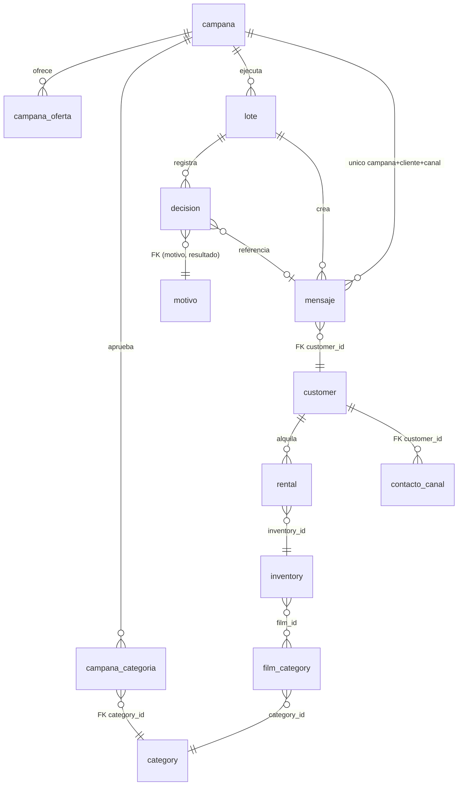

# Campaña de Halloween en DVD Rental — Solución PL/pgSQL

## Resumen

La solución está implementada y probada en PostgreSQL 16 sobre la base DVD Rental: los 9 escenarios mínimos de la actividad se demostraron con evidencia reproducible y las 10 ejecuciones de lote quedaron conciliadas. Todo vive en un esquema nuevo, `campana`; no se modificó ninguna tabla ni dato del modelo original (al final, `customer`=599, `rental`=16 044, `film_category`=1 000 y `category`=16 filas, igual que al restaurar).

Componentes entregados:

- **9 tablas nuevas**: campaña, ofertas, categorías aprobadas, contacto y autorización por canal, catálogo de motivos, lote, mensaje, decisión y auditoría.
- **8 funciones reutilizables**: validan la lista, cuentan alquileres sin multiplicar, evalúan el segmento y cada canal, validan el formato del destino, arman el mensaje e identifican al actor.
- **4 procedimientos**: `sp_preparar_campana` (el principal), además de habilitar, cerrar y registrar una baja.
- **22 triggers**: ciclo de vida, configuración congelada, cancelación por revocación o cierre, mensajes inmutables, tablas de solo inserción, bloqueo de TRUNCATE y auditoría.
- **6 vistas de consulta**: despacho por canal, destinatarios, decisiones, resumen conciliado, estado por cliente y canal, y auditoría.

Los scripts están en [`sql/`](../sql) y las salidas de la ejecución completa en [`resultados/`](../resultados).

## Entorno e instrucciones de ejecución

**GitHub Codespaces (recomendado).** El repositorio trae un devcontainer con dos servicios: `db`, construido con el [`Dockerfile`](../Dockerfile) de la raíz (PostgreSQL 16 que restaura `dvdrental.tar` en el primer arranque), y `app`, la terminal de trabajo con `psql` ya conectado (variables `PGHOST`, `PGUSER`, `PGPASSWORD` y `PGDATABASE`). Al abrir el Codespace basta con:

```bash
bash ejecutar_todo.sh
```

El script reinicia solo el esquema `campana`, instala los objetos, corre los escenarios, lanza dos sesiones simultáneas, genera los reportes y cierra la campaña. Cada paso deja su salida en `resultados/`. Detecta el entorno: con `PGHOST` definido usa `psql` directo; en un equipo con Docker usa `docker exec` sobre el contenedor `pg_dvdrental`.

**Con pgAdmin o psql** contra cualquier PostgreSQL 14+ con dvdrental cargada, ejecutar en este orden:

| Orden | Script | Propósito |
| --- | --- | --- |
| 0 | `00_reset.sql` | Elimina solo el esquema `campana` |
| 1 | `01_esquema.sql` | Tablas, restricciones y catálogo de motivos |
| 2 | `02_funciones.sql` | Funciones reutilizables |
| 3 | `03_triggers.sql` | Triggers |
| 4 | `04_procedimientos.sql` | Procedimiento principal y de ciclo |
| 5 | `05_vistas.sql` | Vistas de consulta |
| 6 | `06_config_campana.sql` | Crea y habilita HALLOWEEN-2026 |
| 7 | `07_datos_prueba.sql` | Contactos ficticios |
| 8 | `08_escenarios.sql` | Escenarios (varios errores son esperados) |
| 9 | `09a` y `09b` en dos consolas; `09c` opcional; luego `09d` | Concurrencia |
| 10 | `10_reportes.sql` | Lista de despacho, decisiones, resumen y auditoría |
| 11 | `11_cierre.sql` | Cierre de la campaña |

Para la sesión en clase basta con repetir `bash ejecutar_todo.sh`: el reinicio deja todo en el mismo punto de partida. Los números de lote y de mensaje pueden variar entre ejecuciones porque las secuencias no retroceden con un ROLLBACK.

## Segmentación sobre el modelo DVD Rental

Un cliente pertenece al segmento si existe, está activo y tiene al menos `min_alquileres` alquileres de una categoría aprobada en el periodo histórico. Con la configuración de la campaña, 6 de los 9 clientes distintos del lote principal quedaron en el segmento.

**Relaciones usadas.** `customer` → `rental` (por `customer_id`) → `inventory` (por `inventory_id`) → `film_category` (por `film_id`) → `category` (por `category_id`). El alquiler (`rental`) es el hecho que se cuenta. `inventory` es el puente obligatorio porque `rental` no apunta a `film`. No se usan `payment`, `store` ni `staff` porque no aportan a la regla.

**Cliente activo.** Se exige `customer.active = 1` **y** `customer.activebool = true`. El modelo tiene los dos indicadores; en los datos hay 15 clientes con `active = 0` y `activebool = true`, así que usar solo `activebool` los incluiría por error.

**Categorías aprobadas** (tabla `campana_categoria`, con justificación obligatoria):

| Categoría | Rol | Justificación |
| --- | --- | --- |
| Horror (id 11) | PRINCIPAL | Es la categoría de terror del catálogo y el género principal de los dos títulos. Un trigger exige que exista para poder habilitar la campaña. |
| Sci-Fi (id 14) | RELACIONADA | Colony: Zona Cero es terror de ciencia ficción (virus biotecnológico e infectados). Es la única categoría del catálogo con ese vínculo temático directo. |
| Action | No aprobada | Colony tiene acción, pero es la categoría de público más amplio: diluiría el segmento de terror. |
| Drama | No aprobada | El drama de The Others no implica afinidad con el terror. |
| Children, Family, Animation | No aprobadas | Son incompatibles con la clasificación +12 y +15 de los títulos. |

El catálogo no tiene Suspenso, Misterio ni Thriller. Solo Horror puede tener el rol PRINCIPAL: un trigger rechaza, por ejemplo, Action como principal.

**Periodo histórico.** El intervalo es semiabierto, `[2005-05-01 00:00, 2006-03-01 00:00)`: `rental_date >= hist_desde` y `rental_date < hist_hasta`. Cubre todo el historial (del 24/05/2005 al 14/02/2006), así que no se descartan datos por ser de años anteriores. El intervalo semiabierto evita ambigüedades con las horas del último día.

**Vigencia promocional.** Es un parámetro independiente: `[2026-10-15, 2026-12-01)`, del estreno de Colony hasta el 30/11/2026, e incluye el reestreno de The Others del 29/10/2026. No se preparan mensajes cuando la fecha actual es igual o posterior a `vig_hasta`. Sí se permite preparar antes de `vig_desde`, para tener la lista lista antes del lanzamiento.

**Conteo sin multiplicación.** `fn_contar_alquileres_aprobados` cuenta filas de `rental` y comprueba la categoría con `EXISTS` (semi-join), sin unir `film_category`. Un alquiler aporta 1 aunque la película tenga varias categorías aprobadas. El mínimo es configurable por campaña (`CHECK min_alquileres >= 1`); se usó 1 porque el enunciado dice "una o más películas".

## Modelo de objetos adicionales

Las 9 tablas nuevas solo referencian al modelo original con claves foráneas a `customer` y `category`; no le agregan columnas, índices ni triggers.



`decision` no tiene clave foránea a `customer` a propósito, porque debe registrar ids inexistentes. `auditoria` no tiene relaciones: la llenan los triggers.

| Tabla | Clave y restricciones clave | Por qué existe |
| --- | --- | --- |
| `campana` | `codigo` único; `CHECK` de estado, `hist_desde < hist_hasta`, `vig_desde < vig_hasta`, `min_alquileres >= 1` | Parametriza la campaña: periodo y vigencia son parámetros independientes |
| `campana_oferta` | PK (campaña, orden); título único | Los títulos son ofertas de campaña; no se buscan en `film` |
| `campana_categoria` | PK (campaña, categoría); FK a `category`; justificación de 10 o más caracteres | Categorías aprobadas explícitas y justificadas |
| `contacto_canal` | PK (cliente, canal); `CHECK`: autorizado exige fecha y fuente, verificado exige fecha y evidencia | Consentimiento y verificación por canal, separados de `customer.email` |
| `motivo` | PK código; único (código, resultado) | Catálogo legible de 10 motivos de inclusión y exclusión |
| `lote` | PK serial | Una fila por ejecución con actor, PID de sesión, lista recibida y resumen |
| `mensaje` | **Único (campaña, cliente, canal)**; `CHECK` de cancelación | Lista de despacho; la restricción única impide duplicados aun con concurrencia |
| `decision` | Único (lote, cliente, canal); FK compuesta (motivo, resultado) | Una decisión por cliente distinto y canal solicitado, coherente con el catálogo |
| `auditoria` | PK serial; JSON antes y después | Evidencia con fecha, actor de negocio y usuario de base de datos |

## Funciones, procedimiento y triggers

Cada regla vive en una sola función. El procedimiento y los triggers reutilizan las mismas funciones, así que una inserción directa se evalúa con las mismas reglas que el lote.

### Funciones (`sql/02_funciones.sql`)

| Función | Contrato | Resultado demostrado |
| --- | --- | --- |
| `fn_normalizar_lista(int[]) → int[]` | Lanza una excepción si la lista es NULL, vacía o tiene elementos NULL. Devuelve los ids distintos ordenados. | `{3,99999,3,1,1}` → `{1,3,99999}`; tres rechazos con mensaje |
| `fn_normalizar_canales(text[]) → text[]` | Normaliza mayúsculas y espacios y quita repetidos. Rechaza un canal distinto de EMAIL o WHATSAPP. | `{' whatsapp','EMAIL','email'}` → `{EMAIL,WHATSAPP}`; SMS rechazado |
| `fn_contar_alquileres_aprobados(campaña, cliente) → int` | Cuenta alquileres en el periodo con alguna categoría aprobada (semi-join). | Cliente 11 con película Horror + Sci-Fi: JOIN ingenuo 2, función 1 |
| `fn_evaluar_segmento(campaña, cliente) → (en_segmento, motivo, alquileres, detalle)` | Revisa existencia, actividad e historial, en ese orden. | 99999 inexistente, 16 inactivo, 20 con 0 alquileres |
| `fn_destino_valido(canal, destino) → bool` | Correo con regex RFC básica, sin `..` y de 254 caracteres como máximo. WhatsApp en formato E.164 (`+` y 8 a 15 dígitos). | `susan.wilson@@correo-prueba` y `3005550003` dan falso |
| `fn_evaluar_canal(cliente, canal) → (apto, motivo, destino, es_prueba, detalle)` | Revisa contacto, luego autorización, formato y verificación. | Los 4 motivos de canal aparecen en el lote 1 |
| `fn_construir_mensaje(campaña, cliente, canal) → (asunto, cuerpo)` | Arma el texto con el nombre, los títulos, el código, la vigencia, la baja y una referencia. No inventa precios. | Vista previa en el escenario E0 |
| `fn_actor() → text` | Actor de negocio de la transacción (`campana.actor`) o, si no hay, el usuario de la base. | Las columnas `creado_por` y `cancelado_por` lo usan |

### Procedimiento principal `sp_preparar_campana`

`CALL campana.sp_preparar_campana(p_codigo, p_customer_ids, p_canales DEFAULT {EMAIL,WHATSAPP}, p_actor, INOUT p_lote_id, INOUT p_resumen)`

1. Valida la lista y los canales; si falla, lanza una excepción y no registra nada.
2. Bloquea la campaña `FOR SHARE` y exige el estado HABILITADA y la vigencia no vencida.
3. Bloquea `FOR SHARE` los contactos de los clientes del lote, en orden.
4. Crea el lote en estado `EN_PROCESO`.
5. Para cada cliente distinto evalúa el segmento. Para cada canal solicitado evalúa el canal e inserta el mensaje con `ON CONFLICT DO NOTHING`. Registra una decisión con su motivo: `PREPARADO_NUEVO`, `YA_PREPARADO`, `MENSAJE_CANCELADO_PREVIO` o una exclusión.
6. Guarda el resumen, marca el lote `COMPLETADO` y lo devuelve en `p_resumen` (JSON).

No hace `COMMIT` ni captura excepciones: todo ocurre en la transacción del `CALL`. Ante cualquier error, PostgreSQL revierte el lote completo. Los procedimientos auxiliares son `sp_habilitar_campana`, `sp_cerrar_campana` y `sp_registrar_baja` (retira la autorización de un canal).

### Triggers (`sql/03_triggers.sql`)

| Trigger | Tabla y momento | Regla que protege |
| --- | --- | --- |
| `trg_campana_ciclo` | campana, BEFORE INSERT, UPDATE, DELETE | Nace en PREPARACION. Solo se permite PREPARACION → HABILITADA → CERRADA (o PREPARACION → CERRADA). Para habilitar exige ofertas y Horror como principal. Congela las reglas al habilitar. La campaña cerrada no cambia ni se reabre. |
| `trg_campana_cierre` | campana, AFTER UPDATE OF estado | El cierre cancela los mensajes pendientes de la campaña |
| `trg_oferta_congelada`, `trg_categoria_congelada` | BEFORE INSERT, UPDATE, DELETE | Ofertas y categorías solo cambian en PREPARACION; solo Horror puede ser PRINCIPAL |
| `trg_contacto_normalizar` | contacto_canal, BEFORE INSERT, UPDATE | Normaliza el destino. Un destino nuevo pierde la verificación anterior. |
| `trg_contacto_cancelar` | contacto_canal, AFTER UPDATE, DELETE | Retirar autorización o verificación, cambiar el destino o borrar el contacto cancela los pendientes de ese canal |
| `trg_mensaje_validar` | mensaje, BEFORE INSERT | Una inserción directa debe cumplir campaña habilitada y vigente, segmento, canal apto y destino idéntico al autorizado |
| `trg_mensaje_proteger` | mensaje, BEFORE UPDATE, DELETE | El contenido es inmutable. Solo se permite PENDIENTE → CANCELADO; un cancelado no se reactiva. No se borra. |
| `trg_lote_proteger`, `trg_decision_validar` | lote y decision | Solo hay lotes en campañas habilitadas; un lote completado es inmutable. Las decisiones solo entran en un lote en curso y para un canal solicitado. |
| `trg_decision_solo_insercion`, `trg_auditoria_solo_insercion` | BEFORE UPDATE, DELETE | Evidencia de solo inserción |
| `trg_*_no_truncate` (5) | BEFORE TRUNCATE | Impide vaciar mensajes, decisiones, lotes, auditoría y contactos |
| `trg_auditar_*` (5) | AFTER INSERT, UPDATE, DELETE | Registra eventos como `MENSAJE_CREADO`, `MENSAJE_CANCELADO`, `CAMPANA_HABILITADA_A_CERRADA` y `CONTACTO_AUTORIZACION_RETIRADA`, con fecha, actor e imagen antes y después |

## Canales, autorización y mensaje

Correo y WhatsApp se evalúan por separado con la misma función. El canal se prepara solo si tiene destino, autorización registrada, formato válido y verificación registrada. Si un canal falla, el otro se evalúa igual: la cliente 4 quedó incluida por correo y excluida por WhatsApp.

- **Fuente del destino.** Nunca se usa `customer.email` ni `address.phone`. Tener un dato de contacto no acredita consentimiento. Todo canal debe estar en `contacto_canal`.
- **Orden de evaluación por canal.** `SIN_CONTACTO` → `SIN_AUTORIZACION` → `DESTINO_INVALIDO` → `DESTINO_NO_VERIFICADO`. El consentimiento va primero porque es la condición legal; luego se revisa la calidad del destino.
- **Evidencia.** Una autorización en `true` exige fecha y fuente, y una verificación en `true` exige fecha y evidencia (restricciones `CHECK`). Ambas quedan citadas en el detalle de cada decisión.
- **Destino inválido.** Se puede guardar para que quede registrado. No genera mensajes y la decisión lo explica.
- **Cambio de destino.** Cancela los pendientes del canal y el destino nuevo queda sin verificar, hasta que se registre una verificación nueva.
- **Datos ficticios.** Las filas de prueba llevan `es_prueba = true`, dominios reservados `.example` y fuentes marcadas `PRUEBA-FICTICIA`. Cada mensaje generado con ellas empieza con `[PRUEBA - DATOS FICTICIOS - NO ENVIAR]`.

Ejemplo real de mensaje preparado (correo de la cliente 3):

```text
Asunto: [PRUEBA - DATOS FICTICIOS - NO ENVIAR] [HALLOWEEN-2026] Halloween en DVD Rental: «Colony: Zona Cero» y «The Others»

[PRUEBA - DATOS FICTICIOS - NO ENVIAR] Hola Linda Williams:

En DVD Rental preparamos la campaña "Halloween en DVD Rental" (código HALLOWEEN-2026) para clientes que disfrutan del cine de terror y géneros afines. Te invitamos a conocer «Colony: Zona Cero» y «The Others».

Consulta en tu tienda DVD Rental los horarios y condiciones vigentes. Campaña vigente del 15/10/2026 al 30/11/2026.

Si no deseas recibir más mensajes de esta campaña por correo electrónico, responde a este correo con la palabra BAJA.
Referencia: HALLOWEEN-2026/3/EMAIL
```

El mensaje de WhatsApp es la versión corta del mismo texto y termina con "Responde BAJA para no recibir más mensajes de esta campaña por WhatsApp". Ningún mensaje menciona precios, descuentos ni disponibilidad. Una baja se registra con `CALL campana.sp_registrar_baja(cliente, canal)`, que cancela los pendientes de ese canal.

## Concurrencia y control transaccional

Dos sesiones simultáneas no generan duplicados porque decide la restricción única `(campana_id, customer_id, canal)`, no una consulta previa. En la prueba, la sesión B esperó 4,1 s el `COMMIT` de A y después reportó como `YA_PREPARADO` los 4 mensajes que A había creado.

| Mecanismo | Qué evita |
| --- | --- |
| `INSERT … ON CONFLICT ON CONSTRAINT uq_mensaje_campana_cliente_canal DO NOTHING` | Duplicados. Si otra sesión insertó la misma clave sin confirmar, esta espera. Si la otra confirma, la fila no se inserta y el lote la registra como ya preparada; si la otra revierte, se inserta. |
| Lista ordenada ascendente (`fn_normalizar_lista`) | Interbloqueos: todas las sesiones toman las claves en el mismo orden |
| `SELECT … FOR SHARE` sobre la campaña | Que un cierre o un cambio concurrente corra a mitad del lote. El cierre espera al final del lote y cancela también lo recién preparado. |
| `FOR SHARE` sobre los contactos del lote | Que se prepare con un destino ya revocado. La revocación espera y luego su trigger cancela lo preparado. |
| Sin `COMMIT` ni `EXCEPTION` dentro del procedimiento | Registros parciales: un error revierte lote, decisiones, mensajes y auditoría juntos |
| Aislamiento READ COMMITTED (el predeterminado) | Que tras la espera no se vea la fila confirmada. Cada sentencia toma una instantánea nueva y lee el mensaje que confirmó la otra sesión. |

**Secuencia observada** (`resultados/09*.txt`):

| Tiempo (UTC) | Sesión A, lista 12, 13, 14 | Sesión B, lista 15, 14, 13, 13 |
| --- | --- | --- |
| t = 0 s | `BEGIN`; lote 11 crea 6 mensajes, sin `COMMIT` | — |
| t = 2 s | Pausa de 6 s | Inicia; al insertar el mensaje de 13 queda en espera |
| t = 4 s | — | El monitor la muestra con `wait_event_type = Lock`, `wait_event = transactionid` |
| t = 6 s | `COMMIT` | Se desbloquea |
| t = 6,1 s | — | Lote 12: 2 mensajes nuevos (cliente 15) y 4 ya preparados (13 y 14); ≈ 4 100 ms en total |

Ambos lotes quedaron con `conciliado = true` y la consulta de duplicados devolvió 0 filas.

## Datos de prueba y resultados de los escenarios

Los 9 escenarios mínimos se cumplieron y las 10 ejecuciones válidas quedaron conciliadas. Hubo 42 decisiones de inclusión y 29 de exclusión en HALLOWEEN-2026, y 0 mensajes duplicados.

### Clientes de prueba (`sql/07_datos_prueba.sql`)

Se eligieron clientes reales de DVD Rental según su historial; solo sus contactos son ficticios.

| Cliente | Perfil real (alquileres Horror / Sci-Fi) | Contactos ficticios | Para qué escenario |
| --- | --- | --- | --- |
| 1 Mary Smith | 0 / 2 | ambos válidos | Elegible solo por la categoría relacionada |
| 3 Linda Williams | 2 / 3 | ambos válidos | Elegible en ambos canales |
| 4 Barbara Jones | 3 / 2 | WhatsApp sin autorización | Autorización en un solo canal |
| 5 Elizabeth Brown | 2 / 0 | solo WhatsApp | Un canal sin contacto |
| 7 Maria Miller | 2 / 0 | ninguno | Sin contacto en ambos canales |
| 8 Susan Wilson | 2 / 2 | correo `@@` mal formado; WhatsApp sin verificar | Destino inválido y no verificado |
| 9, 10, 11 | 1 a 2 alquileres aprobados | ambos válidos | Revocación, cambio de destino, pérdida de verificación y categorías múltiples |
| 12 a 15 | 3 a 7 | ambos válidos | Concurrencia y mínimo configurable |
| 16 Sandra Martin | `active = 0` | ambos válidos | Cliente inactivo |
| 17 a 19 | 2 a 4 | ambos válidos | Error técnico y reversión |
| 20 Sharon Robinson | 0 / 0 | ambos válidos | Historial insuficiente |
| 99999 | no existe | — | Cliente inexistente |

### Escenarios exigidos

| Escenario | Prueba | Resultado obtenido |
| --- | --- | --- |
| Elegible en ambos canales | Lote 1, clientes 1 y 3 | 2 mensajes por cliente (EMAIL y WHATSAPP), `PREPARADO_NUEVO` |
| Autorización en un solo canal | Lote 1, clientes 4 y 5 | 4: solo EMAIL (WhatsApp `SIN_AUTORIZACION`); 5: solo WhatsApp (EMAIL `SIN_CONTACTO`) |
| Varias categorías coincidentes | E4: se agrega Sci-Fi a la película 740 (Horror) dentro de `BEGIN … ROLLBACK` | JOIN ingenuo = 2, función = 1, decisión con `alquileres_aprobados = 1`. Tras el ROLLBACK quedan 0 filas agregadas. |
| Lista o ejecución repetida | Lote 1 con 12 ids (9 distintos) y lote 2 con la misma lista | 18 decisiones cada uno; lote 2: 0 nuevos y 6 `YA_PREPARADO`; consulta de duplicados con 0 filas |
| Inexistente o fuera del segmento | Lote 1, clientes 99999, 16 y 20 | `CLIENTE_INEXISTENTE`, `CLIENTE_INACTIVO` (`active=0`) y `HISTORIAL_INSUFICIENTE` (0 de mínimo 1). Una inserción directa para 20 también fue rechazada. |
| Contacto o autorización inválidos | Lote 1, clientes 7 y 8 | `SIN_CONTACTO` ×2, `DESTINO_INVALIDO` y `DESTINO_NO_VERIFICADO`; ningún mensaje |
| Revocación o cierre | E5 y `11_cierre.sql` | Baja de 9 por correo, cambio de número de 10 y pérdida de verificación de 11: se cancela solo el canal afectado. Al restaurar el permiso queda `MENSAJE_CANCELADO_PREVIO` (no se reactiva). El cierre canceló 23 + 2 pendientes; reabrir, editar, preparar o borrar fue rechazado. |
| Dos sesiones simultáneas | `09a` a `09d` | B esperó 4,1 s; 6 + 2 mensajes en total, sin duplicados; ambos lotes conciliados |
| Error técnico en el lote | E7: trigger de prueba que falla al registrar al cliente 19 | Lotes 6 → 6, decisiones 53 → 53, mensajes 12 → 12, auditoría 59 → 59. Sin la falla, el mismo lote se completó. |

### Pruebas adicionales

- **Validación de la lista (E3).** NULL, vacía, con un NULL y canal SMS fueron rechazadas con mensaje; el número de lotes siguió en 2.
- **Operaciones directas (E6).** Fueron rechazadas 17 operaciones, entre ellas: reactivar o editar un mensaje, borrarlo, insertar uno que no cumple, insertar un duplicado, cambiar reglas u ofertas tras habilitar, volver a PREPARACION, borrar decisiones, editar auditoría o lotes, `TRUNCATE`, mínimo 0 y Action como PRINCIPAL.
- **Mínimo configurable (E8).** La campaña HALLOWEEN-2026-FIELES (mínimo 3, solo Horror) excluyó al cliente 10 (1 alquiler) e incluyó a 12 (5) y a 18 (3). Antes de habilitarla, preparar fue rechazado.

### Resumen de ejecuciones (`v_resumen_lote`)

| Lote | Actor | Recibidos | Distintos | Canales | Segmento | Nuevos | Ya preparados | Decisiones | Exclusiones | Conciliado |
| --- | --- | --- | --- | --- | --- | --- | --- | --- | --- | --- |
| 1 | ana.marketing | 12 | 9 | EMAIL, WHATSAPP | 6 | 6 | 0 | 18 | 12 | sí |
| 2 | ana.marketing | 12 | 9 | EMAIL, WHATSAPP | 6 | 0 | 6 | 18 | 12 | sí |
| 3 | ana.marketing | 1 | 1 | WHATSAPP | 1 | 0 | 1 | 1 | 0 | sí |
| 5 | ana.marketing | 3 | 3 | EMAIL, WHATSAPP | 3 | 6 | 0 | 6 | 0 | sí |
| 6 | ana.marketing | 3 | 3 | EMAIL, WHATSAPP | 3 | 0 | 3 | 6 | 3 | sí |
| 7 | ana.marketing | 2 | 2 | EMAIL, WHATSAPP | 2 | 0 | 2 | 4 | 2 | sí |
| 9 | ana.marketing | 3 | 3 | EMAIL, WHATSAPP | 3 | 6 | 0 | 6 | 0 | sí |
| 10 | ana.marketing (FIELES) | 3 | 3 | EMAIL | 2 | 2 | 0 | 3 | 1 | sí |
| 11 | sesion.A | 3 | 3 | EMAIL, WHATSAPP | 3 | 6 | 0 | 6 | 0 | sí |
| 12 | sesion.B | 4 | 3 | EMAIL, WHATSAPP | 3 | 2 | 4 | 6 | 0 | sí |

Los lotes 4 y 8 no existen: el 4 se revirtió con el ROLLBACK de E4 y el 8 con la falla de E7. Una secuencia no retrocede, así que el hueco es la evidencia de la reversión. `conciliado` comprueba que decisiones = distintos × canales = nuevos + ya preparados + exclusiones, y que los mensajes nuevos coinciden con los mensajes del lote.

## Supuestos, decisiones y límites frente al envío externo

La solución termina en una lista preparada para despacho (`campana.v_despacho`, separada por canal): no envía nada ni se conecta con proveedores. Ningún mensaje generado con datos de prueba debe enviarse.

### Supuestos y criterios tomados

- La lista de marketing llega como `integer[]` de `customer_id`. Los repetidos cuentan en "recibidos" y se evalúan una sola vez.
- Las categorías aprobadas son Horror (principal) y Sci-Fi (relacionada). Se usa un mínimo de 1 alquiler y un periodo que cubre todo el historial.
- Un cliente activo cumple `active = 1` y `activebool = true` a la vez.
- La vigencia es `[2026-10-15, 2026-12-01)`. Se puede preparar antes del inicio, no después del fin. Si la clase ocurre después del 30/11/2026, hay que ajustar `vig_hasta` en `sql/06_config_campana.sql` antes de habilitar.
- Una campaña se puede cerrar desde PREPARACION (cancelación anticipada), pero nunca se reabre.
- Un mensaje cancelado bloquea esa combinación de campaña, cliente y canal para siempre. Para volver a contactar a ese cliente hace falta una campaña nueva.
- El actor de negocio llega como parámetro (`p_actor`). La auditoría guarda además el usuario real de la base (`session_user`), así que el parámetro no oculta quién ejecutó.
- Para probar la regla de varias categorías fue necesario agregar temporalmente una fila a `public.film_category`, porque en DVD Rental cada película tiene una sola categoría. Se hizo dentro de una transacción con ROLLBACK, y se verificó que no persiste.

### Límites de la preparación frente al envío

- **Estado PENDIENTE significa "listo para entregar al proveedor", no "enviado".** Un proceso de despacho externo tendría que leer `v_despacho`, entregar al proveedor (SMTP o WhatsApp Business API) y registrar el resultado en una tabla propia, con estados como ENVIADO, REBOTADO o FALLIDO. Ese proceso está fuera del alcance.
- **Las plantillas de WhatsApp Business deben aprobarse en Meta** antes de usarse. El texto preparado es el contenido propuesto, no una plantilla aprobada.
- **La autorización ficticia (`es_prueba = true`) no es un permiso real.** Un despachador real debe descartar toda fila con `es_prueba = true`, además del prefijo `[PRUEBA …]` que ya lleva el texto.
- **Formato válido no es entregabilidad.** La base comprueba la sintaxis y que exista una verificación registrada. No puede saber si el buzón existe o si el número usa WhatsApp.
- **Las bajas que lleguen por respuesta ("BAJA") las procesa el canal externo,** que debe llamar a `sp_registrar_baja`. Esa llamada cancela los pendientes al instante.
- **Ventana de carrera con el despacho.** Si un despachador ya tomó un mensaje antes de una revocación, la base no puede retirarlo. El despachador debe releer el estado justo antes de enviar.
- **Permisos.** La entrega no define roles. En producción, marketing solo debería tener `EXECUTE` sobre los procedimientos y `SELECT` sobre las vistas, sin escritura directa en las tablas. Aun así, los triggers ya protegen las reglas ante escrituras directas.
